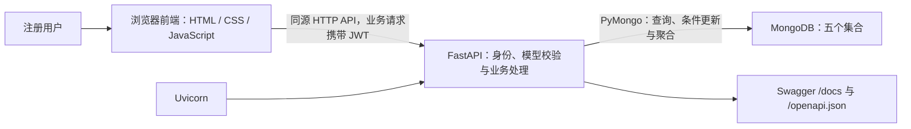
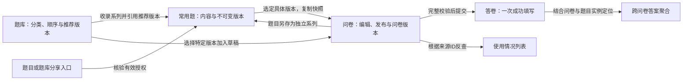

# 基于 MongoDB 的问卷系统第二阶段系统设计

本系统在第一阶段“创建问卷—发布填写—保存答卷—查看统计”的基础上，增加常用题复用、题目与问卷版本、分享、题库，以及使用追踪和跨问卷统计。本文参照第一次提交的系统说明组织，介绍当前完整系统及其运行方式；接口参数、数据库字段、关键逻辑和测试结果分别见本目录03、02、04、05文档。

## 1 系统结构

### 1.1 技术结构



前端由FastAPI挂载到`/ui/`，浏览器通过同一地址访问页面和API，不要求另起前端服务，也没有npm构建步骤。后端启动时连接MongoDB、检查连接、执行兼容迁移和索引准备，然后注册业务路由。根路径`/`重定向到`/ui/`。

| 层次 | 实现方式 | 职责 |
| --- | --- | --- |
| 展示与交互 | 原生HTML、CSS、JavaScript模块 | 工作台、编辑器、整页填写、版本历史、分享、题库和统计 |
| HTTP接口 | FastAPI、Pydantic | 读取登录身份，校验请求与响应模型，返回明确状态码 |
| 业务处理 | app/surveys、app/library | 生命周期、版本派生、来源快照、授权、条件更新和统计口径 |
| 持久化 | MongoDB、PyMongo | 保存用户、问卷版本、常用题版本、题库与答卷，建立索引并执行聚合 |
| 运行与验证 | Uvicorn、unittest、TestClient、Node.js测试工具 | 启动服务、执行真实数据库集成测试与前端逻辑测试 |

### 1.2 业务板块与协作



常用题保存可复用的题干、题型、选项与限制；题库只组织系列、分类和推荐版本，不再保存完整题目副本。问卷保存已选择版本的完整内容和sourceQuestionId，填写与提交依据该问卷快照执行。常用题后来增加新版本，或题库后来更新推荐，都不会自动替换旧问卷。

答卷与问卷定义分开存储，以免问卷随提交次数不断扩大。使用追踪基于来源引用，统计基于成功保存的答卷，不把页面预览或未提交输入当作回答。

## 2 角色与使用流程

### 2.1 身份和权限

系统只有注册用户，没有单独的管理员角色。同一个用户可以同时是问卷作者、题目作者、题库管理者、共享资源使用者和填写者；权限由具体资源的归属、状态和授权决定。

| 操作 | 权限边界 |
| --- | --- |
| 编辑问卷、选题、切换来源或转为独立题 | 仅本人草稿；发布和关闭后锁定内容 |
| 修改常用题内容 | 作者以已有版本为来源创建新版本；没有覆盖旧版本内容的接口 |
| 修改分享开关、管理题库 | 仅资源创建者；题库分享还检查是否包含他人原题 |
| 通过题目或题库分享读取、选用版本 | 必须登录，且分享入口有效、目标属于授权系列 |
| 填写问卷 | 必须登录；问卷已发布、未关闭、未截止，并满足重复限制 |
| 查看答卷或汇总答案 | 仅本人问卷；题目分享不附带他人答卷访问权 |
| 查询题目引用 | 作者可追踪全局引用的受限信息，其他已有使用者仅看本人记录 |

匿名不等于免登录，只表示创建者查看答卷时不显示填写者身份。内部respondentId仍用于重复提交控制。

### 2.2 问卷作者流程

注册或登录 → 创建草稿 → 修改基本信息 → 新建独立题或从常用题/题库选择具体版本 → 配置必答、题序和跳转 → 预览 → 发布 → 分享填写链接 → 查看答卷与统计 → 关闭。

需要改版时，从指定旧版本创建新草稿，保留原问卷与答卷，再在新草稿中编辑或切换来源。新问卷版本有新ID和填写标识，初始无答卷，截止时间清空。

### 2.3 常用题作者与共享使用者流程

作者：创建题目，或把问卷题另存为常用题 → 查看第一版 → 从任意旧版派生新版本 → 必要时恢复历史内容为新版本 → 选择某版本开启分享。

使用者：打开分享入口并登录 → 默认查看入口推荐版本 → 查看同系列其他可读版本 → 选择明确版本 → 加入自己的草稿，或收藏到自己的私人题库。

共享使用不改变原作者。若需要自己维护和再次分享内容，可以从自己问卷另存独立系列；不能直接修改他人原题。

### 2.4 题库整理与选题流程

创建题库 → 收录题目系列 → 指定推荐版本、分类与顺序 → 从题库选版本加入目标草稿；也可以在问卷编辑器中打开题库完成选题。

自己的公开题库可以整理本人题目并分享。含他人原题的私人收藏库继续依赖原授权，不能开启分享；原授权失效后保留收录项，但来源预览失效，新选题被拒绝，已有问卷快照保留。

### 2.5 填写与统计流程

填写者打开问卷链接 → 登录或注册 → 在整页滚动界面按当前路径作答 → 修正提示 → 统一提交 → 查看成功回执。上游答案改变时，前端清除新路径中被跳过题的输入；后端提交时重新计算完整路径，不能只依赖前端隐藏题目。

作者可以查看具体问卷版本的答卷和统计，也可以从常用题版本或已使用来源进入跨问卷统计。后者只合并同一具体题目版本在本人问卷中的答案。页面分别展示提交数、含本题答案的提交数、有效答案数，避免同一答卷多处引用或允许重复填写时混淆次数与人数。

## 3 功能与实现位置

| 功能 | 当前行为 | 主要实现 |
| --- | --- | --- |
| 注册登录 | 用户名唯一，Argon2密码哈希，JWT有效期30分钟 | app/auth/schemas.py、app/auth/security.py、app/api/routes.py |
| 问卷管理 | 本人列表、草稿基本信息修改、题目编辑和题前插入 | app/surveys/schemas.py、app/surveys/questions.py、app/api/routes.py |
| 配置与路径 | 四题型校验；单选匹配、多选完全匹配、数字比较跳转 | app/surveys/questions.py、app/surveys/jumps.py |
| 发布与提交 | draft→published→closed；完整路径校验、匿名与重复限制 | app/surveys/submissions.py |
| 原问卷统计 | 单份问卷、单题统计、答卷与填空内容分页 | app/surveys/statistics.py |
| 常用题版本 | 独立题内容、历史、分支、恢复、分享开关 | app/library/questions.py、app/library/routes.py、app/library/schemas.py |
| 题目复用 | 另存、指定版本加入、插入、切版、detach和固定来源查看 | app/surveys/reuse.py、app/surveys/reuse_routes.py |
| 问卷版本 | 从指定版本创建新草稿、历史摘要和并发版本分配 | app/surveys/versions.py、app/surveys/version_routes.py |
| 题库与分享 | 题库管理、收录与推荐、入口授权、撤销和私人收藏 | app/library/banks.py、app/library/access.py、app/library/bank_routes.py、app/library/share_routes.py |
| 使用追踪 | 具体版本或系列的引用列表、计数与权限过滤 | app/library/statistics.py、app/library/analytics_routes.py |
| 跨问卷统计 | 成对匹配问卷与本地题目ID，数字分桶、选择频次和文本频次 | app/library/statistics.py、frontend/src/pages/question-analysis.js |
| 页面与公共交互 | 工作台、编辑器、版本、题库、分享页、选题和未保存保护 | frontend/src/pages、frontend/src/shared |
| 应用与数据库准备 | 生命周期、路由挂载、静态资源、迁移与索引 | app/main.py、app/core/database.py |
| 调试、测试与展示 | Swagger、隔离库测试、前端逻辑、可保留的模拟账号数据 | /docs、tests/backend、tests/frontend、scripts/seed_analytics_demo.py、scripts/seed_showcase.py |

## 4 关键系统约定

### 4.1 不可变版本与允许修改的配置

常用题每个内容版本单独存储，修改或恢复都插入新版本。问卷的已发布与关闭版本锁定内容，需要变更时创建新草稿。version表示系列内创建顺序，parent记录实际来源，不能用“编号减一”代替父关系。

分享开关、题库推荐、分类和顺序是可以修改的访问或组织配置；这些变化不重写常用题历史内容，也不推送到已有问卷。草稿可以显式切换同系列版本，或移除来源转为独立题。

### 4.2 并发与可信校验

前端提供提示，后端最终检查身份、归属、分享有效性、同系列约束、题型和跳转引用。版本分配依靠联合唯一索引兜底，冲突有限重试；草稿与题库修改匹配读取时的旧状态，冲突返回409，防止旧页面静默覆盖。

当前采用单文档条件更新与独立文档插入，没有把所有跨集合操作放入事务，不保证多个接口的结果来自同一全局时点。

### 4.3 统计范围

引用查询可以按具体版本或整个系列；答案聚合固定到具体版本，且限定本人问卷。数字使用左闭右开的非空区间，最多显示100个；文本显示频次最高的20项及其他答案合计；选项比例由有效答案数计算，多选合计可以超过100%。截断展示不影响全量答案计数和数字均值。

## 5 环境与启动

### 5.1 环境准备

本地开发使用Windows、conda base与Python 3.12。运行依赖见requirements.txt，生成展示数据及执行后端测试还需要requirements-dev.txt中的HTTPX。前端无需安装npm依赖；运行Node.js仅用于前端逻辑测试。

MongoDB需单独安装并运行。以下是当前机器的路径示例，其他机器应替换安装位置和项目位置。

终端一启动数据库；若已经运行，不重复启动：

```powershell
& 'D:\Program Files\mongodb\bin\mongod.exe' --dbpath 'D:\mongodb\data\questinaire' --bind_ip 127.0.0.1 --port 27017
```

数据目录应事先存在。沿用该目录会继续读取已有数据；换成空目录不等于把原库迁移过去。

终端二进入项目、安装依赖并选择数据库：

```powershell
Set-Location -LiteralPath 'D:\code\数据库\作业1'
conda activate base
python -m pip install -r requirements-dev.txt
$env:MONGODB_URI='mongodb://localhost:27017'
$env:MONGODB_DATABASE='questionnaire_demo_usage'
```

MONGODB_URI是服务地址，MONGODB_DATABASE是该服务中的逻辑库名，均不是磁盘目录。未设置时应用默认连接`mongodb://localhost:27017`并使用`questionnaire`；展示账号位于`questionnaire_demo_usage`，因此演示时需明确选库。环境变量只作用于当前终端及其子进程，程序不自动读取.env。

### 5.2 首次生成与普通重启

已有展示数据时跳过生成，直接启动网站。首次初始化展示库按顺序执行：

```powershell
python scripts/seed_analytics_demo.py
python scripts/seed_showcase.py
```

基础脚本写入questionnaire_demo_usage并保存本地清单；成果脚本从该清单读取库名，再生成完整成果账号。脚本自身加载应用调用正式API，只要求MongoDB已经运行，不要求提前启动Uvicorn。

生成清单位于var目录，包含操作记录、资源ID和链接，不是数据库备份，也不保存访问令牌。更换为空数据库但保留旧清单时，不应把旧ID当成可恢复的数据；完整首次启动及清单处理见[成果展示说明](<../implementation/14 成果展示账号与演示流程.md>)。普通重启不需要重新生成账号或答卷。

启动网站：

```powershell
python -m uvicorn app.main:app --host 127.0.0.1 --port 8021
```

数据库与网站两个进程均需保持运行。启动时自动准备索引和兼容迁移，无需手工建立集合。若需要服务重启后保持已签发JWT有效，可设置不少于32字节且保密的JWT_SECRET；未设置时进程生成临时密钥，重启后重新登录即可。

### 5.3 页面与验证入口

| 地址 | 用途 |
| --- | --- |
| `http://127.0.0.1:8021/` | 重定向到正式前端 |
| `http://127.0.0.1:8021/ui/` | 登录、工作台 |
| `http://127.0.0.1:8021/docs` | Swagger接口调试 |
| `http://127.0.0.1:8021/openapi.json` | 当前完整接口结构 |
| `http://127.0.0.1:8021/health` | 服务与数据库连接检查 |
| `/ui/#/questions`、`/ui/#/banks` | 常用题与题库页面 |
| `/ui/#/survey-versions/{surveyId}` | 问卷版本历史 |
| `/ui/#/fill/{shareToken}` | 浏览器填写页面 |
| `/ui/#/shared-question/{token}`、`/ui/#/shared-bank/{token}` | 题目或题库分享页面 |
| `/ui/#/question-analysis/{questionVersionId}` | 具体题目版本使用情况及统计 |

页面hash路由不是API路径，例如填写数据API为`/survey/{share_token}`。所有本阶段共享业务API仍要求登录。

完整展示账号：`showcase`，密码`Showcase-2026!`。初始数据包含8个问卷版本、66份答卷、3个题库、7道常用题的11个版本；人工编辑或继续填写后数量会正常变化。账号是模拟演示数据，不代表真实受访者信息。

本文件描述当前设计和启动方法，不把历史通过数字作为本次重新测试的结果；执行记录与覆盖边界见[05 测试用例与结果](<05 测试用例与结果.md>)。
