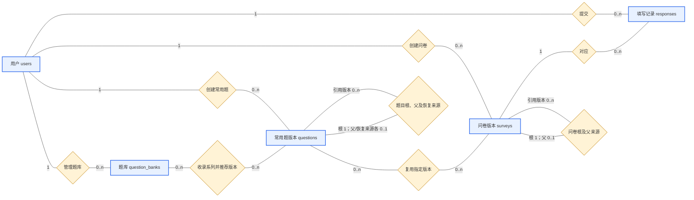

# 问卷系统第二阶段 MongoDB 数据库设计

本设计以当前持久化代码为准，在第一阶段users、surveys、responses基础上增加questions和question_banks。本文给出集合概念、联系、全部持久化属性、嵌入结构、索引与约束，包含第一阶段保留字段和第二阶段新增字段，而不只列新增内容。

## 1 概念关系与存储选择

### 1.1 业务概念

| 概念           | 表示什么                                         | 持久化位置                                   |
| -------------- | ------------------------------------------------ | -------------------------------------------- |
| 用户           | 统一登录身份，可以创建资源和填写问卷             | users独立文档                                |
| 问卷系列       | 围绕同一根问卷演进的一组版本                     | surveys.rootSurveyId分组，不另建系列集合     |
| 问卷版本       | 一份具体的可编辑、发布或关闭的问卷定义           | surveys独立文档                              |
| 问卷内题目实例 | 某份问卷中一个位置的具体题目，可独立或来自常用题 | surveys.questions嵌入文档                    |
| 常用题系列     | 一道可复用题目的全部内容版本                     | questions.rootQuestionId分组，不另建母题集合 |
| 常用题版本     | 一条固定题干、选项与限制的内容版本               | questions独立文档                            |
| 选项           | 选择题的一个可选内容及稳定标识                   | 题目内options数组                            |
| 跳转规则       | 按当前答案选择后续题目或结束                     | 问卷题目内jumpRules数组                      |
| 题库           | 创建者维护的题目整理、分类与推荐入口             | question_banks独立文档                       |
| 收录项         | 一个题库对某系列的收录及推荐版本                 | question_banks.items嵌入文档                 |
| 填写记录       | 一次成功提交，含身份、时间和整组答案             | responses独立文档                            |
| 答案           | 一次提交中对某个本地题目实例的有效回答           | responses.answers嵌入文档                    |

概念数量不等于集合数量。选项、规则、收录项和答案没有各自独立集合；题目系列与问卷系列也没有单独的母体文档。

### 1.2 集合及嵌入/引用边界

| 集合           | 一个文档代表什么       | 嵌入什么                             | 引用什么                                      |
| -------------- | ---------------------- | ------------------------------------ | --------------------------------------------- |
| users          | 一个用户               | 基础账号属性                         | 无业务外键                                    |
| surveys        | 一个具体问卷版本       | 题目、选项、validation和jumpRules    | 用户、根/父问卷版本、题目实例的常用题版本来源 |
| responses      | 一次成功提交           | answers及所选选项ID集合或填写值      | 具体问卷版本、填写用户，以及问卷内题目实例    |
| questions      | 一个不可变的常用题版本 | 内容、选择题选项和validation         | 作者、根/父题目版本、恢复内容来源             |
| question_banks | 一个题库               | 收录项、分类、顺序及必要的原授权信息 | 所有者、题目根版本与推荐版本                  |

问卷定义整体读取与修改，适合嵌入题目和规则；答卷独立增长，不嵌入问卷。常用题需要跨问卷复用并独立演进，因此分为独立集合，同时在问卷中保留内容快照。题库只保存引用和推荐信息，不再持久化完整原题预览。

### 1.3 关系与基数

| 联系              | 基数及约束                                                       | 连接字段                                                         |
| ----------------- | ---------------------------------------------------------------- | ---------------------------------------------------------------- |
| 用户创建问卷      | 一个用户可有0至多份问卷版本，每份有一个创建者                    | surveys.creatorId→users._id                                     |
| 用户创建常用题    | 一个用户可有0至多个题目版本，每版本有一个作者                    | questions.creatorId→users._id                                   |
| 用户管理题库      | 一个用户可有0至多个题库，每库有一个所有者                        | question_banks.creatorId→users._id                              |
| 用户提交答卷      | 一个用户可有0至多次提交，每次内部保留一个填写者                  | responses.respondentId→users._id                                |
| 问卷对应答卷      | 一个具体问卷版本可有0至多份答卷，每份属于一个版本                | responses.surveyId→surveys._id                                  |
| 问卷包含题目      | 一份草稿可有0至多题，发布至少一题；每实例属于该问卷定义          | surveys.questions[].questionId                                   |
| 常用题被问卷复用  | 按集合文档是多对多；每次复用实例只指向一个具体版本，独立题无来源 | surveys.questions[].sourceQuestionId→questions._id              |
| 题库收录系列      | 按集合文档是多对多；同库同系列最多一项                           | question_banks.items[].rootQuestionId→questions._id中的系列首版 |
| 题库推荐版本      | 一个库可推荐多个系列的版本，一个版本可被多个题库推荐             | items[].recommendedVersionId→questions._id                      |
| 题目版本归根      | 每个版本有一个根，首版根指向自身                                 | questions.rootQuestionId→questions._id                          |
| 题目版本派生/恢复 | 每版最多一个父来源、一个恢复内容来源，可被多个后续版本引用       | parentQuestionId、restoredFromQuestionId→questions._id          |
| 问卷版本归根/派生 | 每版有一个根，最多一个父来源；首版父为空                         | rootSurveyId、parentSurveyId→surveys._id                        |
| 记录包含答案      | 一次提交可保存0至多项有效答案，同次本地题目ID不重复              | responses.answers[].questionId                                   |
| 答案对应题目      | 结合surveyId定位其问卷内题目；不能只用questionId跨版本定位       | (responses.surveyId, answers[].questionId)                       |

关系表示应用语义，不是MongoDB自动检查的外键。答案不直接引用questions._id，必须先通过问卷内实例的sourceQuestionId才能确定常用题来源。

### 1.4 集合关系图

采用矩形表示集合、菱形表示联系，与第一阶段的概念图风格一致。为便于阅读，图中画集合级关系，嵌入结构与全部属性在后续数据字典展开。



0..n表示可以没有，也可以有多个；0..1表示可空的单一来源。首版本的根ID指向自身。题库内每个收录项有一个根ID和一个推荐版本ID，且必须属于同一系列；图中的合并联系不表示两类ID相同。

## 2 类型、默认值与数据边界

- 本文ObjectId指MongoDB中实际保存的ID类型；API把它序列化为24位十六进制字符串，顶层_id通常输出为id，嵌入题使用questionId。
- Date为BSON日期，服务端生成UTC时间。MongoDB日期按毫秒保存，API使用带时区的ISO字符串。创建后回读持久化结果，避免时间精度导致响应与数据库不一致。
- integer由PyMongo按实际值编码为BSON整数；数字题允许64位整数范围内的整数或有限double，不接受NaN、Infinity和布尔值作为数字。某些聚合中间值使用Decimal128，不表示所有答案都存成Decimal128。
- 字符串题干、名称、选项文字去首尾空白且非空；说明文字可为空。填写文本只把全空白视作未填，不把一般答案自动裁剪后保存。
- “可省略”表示持久化时可以没有此键；“可为null”表示允许显式空值。部分API响应按模型补出null，不应当据此推断库内所有字段都实际存在。
- 以下列出的约束包括Pydantic、业务层和索引约束。当前没有部署MongoDB的$jsonSchema集合验证器；直接绕过API写库不能保证仍满足全部约束。

## 3 MongoDB schema--属性字典

### 3.1 users：用户集合

| 字段         | BSON类型 | 默认、约束与用途                                  |
| ------------ | -------- | ------------------------------------------------- |
| `_id`      | ObjectId | MongoDB生成用户标识                               |
| username     | string   | 去首尾空白后1至50字符，默认区分大小写；唯一登录名 |
| passwordHash | string   | Argon2哈希；注册请求密码8至128字符，明文不持久化  |
| createdAt    | Date     | 服务端生成创建时间                                |

用户响应只返回id、username、createdAt。JWT为临时登录凭据，不保存为users字段；系统没有新增管理员角色或额外资料属性。

### 3.2 surveys：具体问卷版本集合

| 字段           | BSON类型          | 默认、约束与用途                                       |
| -------------- | ----------------- | ------------------------------------------------------ |
| `_id`        | ObjectId          | 具体问卷版本ID，创建新版本时重新生成                   |
| creatorId      | ObjectId          | 从登录身份取得，引用users；客户端不能指定              |
| rootSurveyId   | ObjectId          | 系列第一版ID，第一版等于自身_id；第二阶段新增          |
| parentSurveyId | ObjectId或null    | 实际复制来源版本ID，第一版null；第二阶段新增           |
| version        | integer           | 首版1，同系列新版本取最大编号加一；第二阶段新增        |
| title          | string            | 去首尾空白，非空                                       |
| description    | string            | 默认空字符串                                           |
| allowAnonymous | bool              | 默认false；允许匿名仍需登录                            |
| allowRepeat    | bool              | 默认false；按具体问卷版本限制重复                      |
| createdAt      | Date              | 当前版本创建时间                                       |
| status         | string            | 初始draft；生命周期draft→published→closed            |
| deadline       | Date或null        | 初始null；发布设置时须带时区且晚于发布时刻，null不限时 |
| shareToken     | string            | 服务端随机生成，唯一，作为该具体版本的填写入口         |
| questions      | array of document | 初始空数组；发布至少一题，通常按order排序保存          |

过期由deadline判断，不额外保存expired状态。发布和关闭后不允许改写问卷内容。创建新版本复制内容与开关，生成新ID和分享标识，重置draft与deadline=null，不复制responses。

#### 3.2.1 surveys.questions[]：问卷内题目实例

| 字段             | BSON类型                    | 默认、约束与用途                                                |
| ---------------- | --------------------------- | --------------------------------------------------------------- |
| questionId       | ObjectId                    | 问卷内稳定实例标识；追加生成，普通编辑/切版保留；同一问卷内唯一 |
| sourceQuestionId | ObjectId，可省略            | 指向常用题具体版本questions._id；独立题不保存；第二阶段新增     |
| title            | string                      | 非空题干，引用题保存来源版本的内容快照                          |
| type             | string                      | single、multiple、text、number之一                              |
| order            | integer                     | 正整数，最大2147483647，同一问卷内唯一，不强制连续              |
| required         | bool                        | 默认false；前端“是否可选”与其反向映射                         |
| options          | array of document，条件保存 | 仅single/multiple保存，至少2项；填空题不保存                    |
| validation       | document                    | 四题型限制结构，详见3.4；字段可省略，但文档对象保留             |
| jumpRules        | array of document           | 默认空数组；保存本问卷实例专属的跳转规则                        |

sourceQuestionId不是根题目ID，不能自动跟随最新版本。一个版本可以生成多个不同的问卷实例；不同问卷版本复制时可能保留相同questionId，因此跨问卷定位必须加上surveyId。

普通题目PUT允许调整问卷内配置，但不能改写带来源的内容字段；需创建来源新版本后切换，或detach后独立编辑。另存常用题不自动给原实例添加来源。

#### 3.2.2 surveys.questions[].options[]：选项

| 字段     | BSON类型 | 默认、约束与用途                                 |
| -------- | -------- | ------------------------------------------------ |
| optionId | ObjectId | 服务端生成；当前题内唯一；编辑保留旧项时带回原ID |
| text     | string   | 去首尾空白后非空                                 |
| order    | integer  | 正整数，最大2147483647；同题内唯一，按序保存     |

常用题复制到问卷时同时复制其选项ID；不同本地实例可以具有相同来源选项ID，答案必须先定位具体题目，不能单凭optionId判断所属题目。

#### 3.2.3 surveys.questions[].jumpRules[]：跳转规则

| 字段             | BSON类型                       | 默认、约束与用途                                                                     |
| ---------------- | ------------------------------ | ------------------------------------------------------------------------------------ |
| operator         | string                         | single仅selected；multiple仅exactly；number为<、<=、=、>=、>之一；text不支持非空规则 |
| value            | ObjectId、ObjectId数组或number | selected为本题一个选项ID；exactly为非空不重复的本题选项ID集合；数字比较为有限数值    |
| targetQuestionId | ObjectId或null                 | 必须提供；非空时指向同问卷中order更大的题目；null表示结束                            |

按规则数组顺序取首条命中；未命中或非必答题为空时按题序继续。exactly比较完整选项集合，忽略顺序，子集或超集不命中。禁止自跳、向前和跨问卷目标；编辑完成后重新校验引用。

### 3.3 questions：常用题版本集合

| 字段                   | BSON类型                    | 默认、约束与用途                                                |
| ---------------------- | --------------------------- | --------------------------------------------------------------- |
| `_id`                | ObjectId                    | 具体题目版本ID，供问卷sourceQuestionId引用                      |
| creatorId              | ObjectId                    | 题目作者，创建时从登录身份取得                                  |
| rootQuestionId         | ObjectId                    | 系列第一版ID，首版等于自身_id                                   |
| parentQuestionId       | ObjectId或null              | 实际修改来源版本，首版null                                      |
| restoredFromQuestionId | ObjectId或null              | 恢复时复制的历史内容来源；普通创建/派生为null                   |
| version                | integer                     | 首版1，同根系列内递增且唯一，与父版本编号不必相邻               |
| title                  | string                      | 去首尾空白后的非空题干                                          |
| type                   | string                      | single、multiple、text、number之一                              |
| options                | array of document，条件保存 | 选择题适用，至少2项，子字段为optionId、text、order，与3.2.2相同 |
| validation             | document                    | 题型限制，与3.4相同；不包含问卷的required设置                   |
| shareToken             | string                      | 服务端随机生成，唯一，分享入口推荐本版本                        |
| sharingEnabled         | bool                        | 默认false；控制此入口，不改变题目内容                           |
| createdAt              | Date                        | 当前版本创建时间                                                |

questions不保存问卷内questionId、问卷题序order、required或jumpRules。options内部order是选项顺序，不是问卷题序。

创建新系列的选项均由服务端生成ID；派生时只允许引用所选父版本已有optionId，新选项省略ID。恢复复制历史内容和选项身份，但仍新建版本，分别记录父来源和恢复来源。

版本内容没有覆盖或删除接口，也没有updatedAt属性。sharingEnabled可单独改变，shareToken不会因为开启/关闭而转为JWT。版本分配、根父关系由服务端生成，不能由请求自报version、creatorId或rootQuestionId。

### 3.4 共用validation的全部属性

以下限制同时适用于questions.validation和surveys.questions[].validation。不同题型只允许自己的字段，不能把maxChoices放进数字题等。

| 题型     | 字段        | BSON类型                | 缺省含义与约束                                                      |
| -------- | ----------- | ----------------------- | ------------------------------------------------------------------- |
| single   | 无额外字段  | 空document              | validation为{}；作答时只能选一项本题选项                            |
| multiple | minChoices  | integer，可省略         | 未配置视为0；非负且不超过选项数，最大2147483647                     |
| multiple | maxChoices  | integer，可省略         | 未配置视为选项数；非负且不超过选项数，且不小于minChoices            |
| text     | minLength   | integer，可省略         | 未配置视为0；非负，最大2147483647                                   |
| text     | maxLength   | integer，可省略         | 未配置不限；非负且不小于minLength，最大2147483647                   |
| number   | minValue    | integer或double，可省略 | 未配置无下界；有限数字                                              |
| number   | maxValue    | integer或double，可省略 | 未配置无上界；有限数字且不小于minValue                              |
| number   | integerOnly | bool                    | 默认false；true时答案数值必须为整数，给定双边范围内须存在可填写整数 |

对可选限制传入null后保存时去掉该限制字段，而不是在比较时把null当数值0。数字题integerOnly的默认false会作为校验内容保存。文本长度按Unicode码点计算。

required与限制分开：非必答题完全不填时可跳过，即使配置了正数minChoices或minLength；填写后须满足限制。必答多选题不能使用maxChoices=0。单选至少2个选项，不代表每次至少选2项。

### 3.5 question_banks：题库集合

| 字段           | BSON类型          | 默认、约束与用途                      |
| -------------- | ----------------- | ------------------------------------- |
| `_id`        | ObjectId          | 题库ID                                |
| creatorId      | ObjectId          | 题库所有者，仅其可修改或删除          |
| name           | string            | 去首尾空白后非空                      |
| description    | string            | 默认空字符串                          |
| shareToken     | string            | 服务端随机生成，唯一，题库分享入口    |
| sharingEnabled | bool              | 默认false；含他人原题时不能开启       |
| createdAt      | Date              | 创建时间                              |
| updatedAt      | Date              | 初始等于createdAt，成功修改题库时更新 |
| items          | array of document | 默认空数组，按order排序；收录项见下表 |

#### 3.5.1 question_banks.items[]：收录项

| 字段                 | BSON类型         | 默认、约束与用途                                               |
| -------------------- | ---------------- | -------------------------------------------------------------- |
| rootQuestionId       | ObjectId         | 收录的系列首版ID，同一题库最多一项                             |
| recommendedVersionId | ObjectId         | 当前推荐具体版本，必须与rootQuestionId属于同系列               |
| category             | string           | 默认空字符串，保存时去首尾空白                                 |
| order                | integer          | 正整数，最大2147483647，同库内不能与其他收录项重复，不要求连续 |
| addedAt              | Date             | 初次加入时间，更新推荐或分类时保留                             |
| accessProof          | document，可省略 | 仅外来原题需要，保存原授权入口；自己的题目通常不保存           |

收录项没有独立_id。更新已有项需提交expectedRecommendedVersionId，读取时推荐值已变化则409；首次收录不能提供一个伪装的旧值。删除项同样检查旧推荐版本。这些旧值字段属于请求校验，不持久化到items。

题库列表/详情与分享响应均不暴露accessProof。详情中返回的question是运行时查询推荐版本生成的预览，不是question_banks内的持久化属性；授权失效时question=null，仍保留可移除的收录项。

#### 3.5.2 question_banks.items[].accessProof：原授权

| 字段               | BSON类型       | 约束与用途                                   |
| ------------------ | -------------- | -------------------------------------------- |
| questionShareToken | string，可省略 | 原题某个有效分享版本的入口，必须授权相同系列 |
| bankShareToken     | string，可省略 | 原共享题库的入口，必须仍收录且允许传播该系列 |

两者为替代入口，不同时保存为两个并行授权。选择自己的收藏库bankId时，后端先找到收录项，再使用其中已保存的原授权；不会把bankId继续保存成递归授权链。对来源授权每次重新校验，撤销后不能只靠私人收藏继续访问来源。

### 3.6 responses：一次成功提交集合

| 字段             | BSON类型          | 默认、约束与用途                                                 |
| ---------------- | ----------------- | ---------------------------------------------------------------- |
| `_id`          | ObjectId          | 每次成功提交生成一条记录                                         |
| surveyId         | ObjectId          | 指向具体问卷版本，不是根问卷ID                                   |
| respondentId     | ObjectId          | 从登录身份取得，匿名记录内部仍保留                               |
| isAnonymous      | bool              | 请求默认false；true时要求问卷allowAnonymous=true                 |
| submittedAt      | Date              | 服务端生成提交时间                                               |
| repeatRestricted | bool              | 保存为not survey.allowRepeat，供部分唯一索引使用，不由客户端决定 |
| answers          | array of document | 当前实际路径中填写的非空有效答案；允许合法的空答案数组           |

未提交输入和路径预览不保存为responses。一次提交在完整校验后整体插入，不是每答一题生成一条填写记录。

#### 3.6.1 responses.answers[]：答案

| 字段              | BSON类型                          | 默认、约束与用途                                                    |
| ----------------- | --------------------------------- | ------------------------------------------------------------------- |
| questionId        | ObjectId                          | 必须属于surveyId所指问卷内的实际路径，同一次提交不得重复            |
| selectedOptionIds | array of ObjectId，条件保存       | 仅single/multiple答案；不得重复或引用外来选项，单选有答案时恰好一项 |
| value             | string、integer或double，条件保存 | 仅text/number答案；文本必须字符串，数字必须有限数值并满足限制       |

选择题只保存questionId与selectedOptionIds；填空题只保存questionId与value，不同时保存两类答案字段。非必答题空值、空选项集合或全空白文本被视为未回答，不生成该答案项。answer没有独立_id或responseId字段，因为所属填写记录由外层文档确定。

匿名记录在返回创建者时把respondentId置为null，数据库内部不删身份；提交回执不返回填写者ID。跨问卷答案聚合不输出填写者身份。

### 3.7 非持久化数据与兼容字段

| 名称                                                   | 性质                                                                               |
| ------------------------------------------------------ | ---------------------------------------------------------------------------------- |
| access_token、token_type、expires_in                   | 登录响应，临时凭据，不是users字段                                                  |
| expectedSourceQuestionId、expectedRecommendedVersionId | 乐观并发校验的请求旧值，不是新增数据库属性                                         |
| clearJumpRules、beforeQuestionId                       | 操作参数，不持久化为题目字段                                                       |
| bankId、questionShareToken、bankShareToken             | 选题/切版/收录的访问参数；只有外来收藏会把规范化原入口存入accessProof              |
| question预览、统计计数、均值与分布                     | 查询时派生的响应，不维护为额外集合或累计缓存属性                                   |
| accessToken                                            | 更早版本的问卷历史字段；缺少shareToken时保留值重命名为shareToken，不是当前新建结构 |

## 4 MongoDB schema--所有索引与数据库约束

### 4.1 索引清单

五个集合都保留默认_id唯一索引。当前代码另外创建12个索引，共17个索引实例；下表逐项列出，不把数组内业务去重当成数据库索引。

| 集合           | 索引键                                   | 唯一性/条件                       | 用途                                              |
| -------------- | ---------------------------------------- | --------------------------------- | ------------------------------------------------- |
| users          | `{_id:1}`                              | 默认唯一                          | 用户ID定位                                        |
| users          | `{username:1}`                         | 唯一                              | 用户名登录与并发注册冲突                          |
| surveys        | `{_id:1}`                              | 默认唯一                          | 具体问卷版本定位                                  |
| surveys        | `{shareToken:1}`                       | 唯一                              | 通过填写入口定位问卷版本                          |
| surveys        | `{creatorId:1, createdAt:-1, _id:-1}`  | 普通联合索引                      | 本人列表及创建时间/ID稳定排序                     |
| surveys        | `{rootSurveyId:1, version:1}`          | 联合唯一                          | 同系列历史与并发版本取号                          |
| surveys        | `{"questions.sourceQuestionId":1}`     | 普通多键索引                      | 通过嵌入题来源查引用问卷                          |
| questions      | `{_id:1}`                              | 默认唯一                          | 具体题目版本定位                                  |
| questions      | `{rootQuestionId:1, version:1}`        | 联合唯一                          | 查询系列历史，防止同根版本重号                    |
| questions      | `{shareToken:1}`                       | 唯一                              | 题目分享入口                                      |
| questions      | `{creatorId:1, createdAt:-1, _id:-1}`  | 普通联合索引                      | 按作者定位与列表排序                              |
| question_banks | `{_id:1}`                              | 默认唯一                          | 题库ID定位                                        |
| question_banks | `{shareToken:1}`                       | 唯一                              | 题库分享入口                                      |
| question_banks | `{creatorId:1, createdAt:-1, _id:-1}`  | 普通联合索引                      | 本人题库列表与稳定排序                            |
| responses      | `{_id:1}`                              | 默认唯一                          | 提交记录定位                                      |
| responses      | `{surveyId:1, respondentId:1}`         | 部分唯一；仅repeatRestricted=true | 名称one_response_per_user，限制同人同版本重复提交 |
| responses      | `{surveyId:1, submittedAt:-1, _id:-1}` | 普通联合索引                      | 按问卷筛选、提交时间分页，支持聚合前限制范围      |

部分唯一索引的实际过滤表达式为`{repeatRestricted:true}`。允许重复时记录不进入这项唯一约束，不能理解为“同用户永远只能有一条答卷”。同系列不同问卷版本的surveyId不同，可以分别填写。

shareToken只要求在各自集合内唯一；问卷、题目与题库有独立入口，不是共享一个全站token唯一索引。关系字段、嵌入题序和选项身份的正确性仍需应用校验。

### 4.2 一致性与并发写入

- **版本分配**：按系列最大version加一，插入碰撞后重新取号和生成分享标识，最多16次；父来源保持用户选定的版本，耗尽返回409。
- **问卷结构更新**：匹配_id、creatorId、status=draft和读取时旧questions数组，再保存候选完整数组。期间发布或改动导致不匹配，返回409，不覆盖新状态。
- **题库更新或删除**：匹配原_id、creatorId、name、description、items、sharingEnabled；读后被改动则拒绝旧更新。
- **重复提交**：校验完整路径与当前可用性，再写入一条responses；并发重复由部分唯一索引最终拦截，而不只依靠先查再写。
- **应用约束**：同题序/选项ID/选项顺序/收录根ID与顺序去重、引用归属、版本同根和授权有效性由服务层完成。没有声明跨集合外键或用嵌入数组唯一索引替代这些检查。

## 5 相互关联的文档结构示例

下面使用MongoDB Shell风格表示五个集合的结构，ID与token均为说明性值，不是当前展示库真实记录。示例为同一用户创建常用数字题、题库和含复用题/独立题的问卷，并提交一份匿名答卷。

```javascript
// users：用户
{
  _id: ObjectId("000000000000000000000001"),
  username: "alice",
  passwordHash: "$argon2id$...服务端生成的哈希...",
  createdAt: ISODate("2026-10-25T00:00:00Z")
}

// questions：年龄题的第一版
{
  _id: ObjectId("000000000000000000000101"),
  creatorId: ObjectId("000000000000000000000001"),
  rootQuestionId: ObjectId("000000000000000000000101"),
  parentQuestionId: null,
  restoredFromQuestionId: null,
  version: 1,
  title: "你的年龄", type: "number",
  validation: {minValue: 0, maxValue: 120, integerOnly: true},
  shareToken: "example-question-token",
  sharingEnabled: false,
  createdAt: ISODate("2026-10-25T00:01:00Z")
}

// question_banks：收录该系列，推荐同一具体版本
{
  _id: ObjectId("000000000000000000000501"),
  creatorId: ObjectId("000000000000000000000001"),
  name: "校园调查题库", description: "常用基础指标",
  shareToken: "example-bank-token", sharingEnabled: true,
  createdAt: ISODate("2026-10-25T00:02:00Z"),
  updatedAt: ISODate("2026-10-25T00:03:00Z"),
  items: [{
    rootQuestionId: ObjectId("000000000000000000000101"),
    recommendedVersionId: ObjectId("000000000000000000000101"),
    category: "基础信息", order: 1,
    addedAt: ISODate("2026-10-25T00:03:00Z")
  }]
}

// surveys：具体问卷v1，含来源题和独立题
{
  _id: ObjectId("000000000000000000000201"),
  creatorId: ObjectId("000000000000000000000001"),
  rootSurveyId: ObjectId("000000000000000000000201"),
  parentSurveyId: null, version: 1,
  title: "校园学习调查", description: "结构示例",
  allowAnonymous: true, allowRepeat: false,
  createdAt: ISODate("2026-10-25T00:04:00Z"),
  status: "published", deadline: null,
  shareToken: "example-survey-token",
  questions: [{
    questionId: ObjectId("000000000000000000000301"),
    sourceQuestionId: ObjectId("000000000000000000000101"),
    title: "你的年龄", type: "number", order: 1, required: true,
    validation: {minValue: 0, maxValue: 120, integerOnly: true},
    jumpRules: [{operator: "<", value: 18, targetQuestionId: null}]
  }, {
    questionId: ObjectId("000000000000000000000302"),
    title: "你的建议", type: "text", order: 2, required: false,
    validation: {maxLength: 200}, jumpRules: []
  }]
}

// responses：年龄20未提前结束，继续填写建议；匿名只隐藏外部展示身份
{
  _id: ObjectId("000000000000000000000401"),
  surveyId: ObjectId("000000000000000000000201"),
  respondentId: ObjectId("000000000000000000000001"),
  isAnonymous: true, repeatRestricted: true,
  submittedAt: ISODate("2026-10-25T01:00:00Z"),
  answers: [{
    questionId: ObjectId("000000000000000000000301"), value: 20
  }, {
    questionId: ObjectId("000000000000000000000302"), value: "增加自习空间"
  }]
}
```

若收藏他人授权原题，收录项可能另外包含`accessProof:{questionShareToken:"原入口token"}`或`accessProof:{bankShareToken:"原题库token"}`，两者择一；自己的题目如示例不需要此属性。

## 6 版本、权限和统计中的关系使用

### 6.1 不可变与允许变化的部分

常用题内容版本一经保存不覆盖，派生和恢复均插入新文档。问卷已发布/关闭后锁定，改版创建新草稿；旧答卷仍指向原surveyId。分享开关和题库推荐可以改变，但不会自动替换原问卷内容。

从草稿来源Q1切到同系列Q2时，更新内容快照和sourceQuestionId，保留本地questionId、题序和required并重验规则。detach只移除来源键，此后可独立编辑。另存操作重新生成独立系列及选项身份，不自动修改原问卷。

### 6.2 归属、授权与撤销

原作者拥有常用题编辑与分享管理权；被分享者只能读和用，不改变creatorId。题目入口推荐该分享版本，题库入口推荐各项recommendedVersionId；同系列其他版本可在有效授权下选择，推荐不会自动随最新版本改变。

关闭入口、移除共享题库项或删除题库后，该授权路径不能再支持新访问；其他有效授权路径仍可使用。原问卷快照、历史答案和已有使用者查看固定来源的能力不被删除。含他人原题的私人题库不能开启分享，已经分享的题库也不能收录外来原题。

### 6.3 使用追踪与答案匹配

具体版本引用查询直接按surveys.questions.sourceQuestionId匹配；系列范围先查questions.rootQuestionId下的全部版本ID，再匹配来源。作者可见外部引用的受限记录，其他使用者只查询自己的问卷，独立题或detach题不属于来源引用。

跨问卷统计始终限制本人问卷和一个具体题目版本。先建立每份问卷的匹配本地题目ID集合，再按(surveyId, questionId)成对匹配答案，避免同一嵌入ID在不同问卷版本出现时串入其他来源。

submissionCount是相关问卷成功提交总数，answeredSubmissionCount是至少回答一处来源题的提交数，answerCount是所有匹配位置的答案数。同一答卷两处作答会贡献两个答案；重复提交按记录计，不是去重人数。统计结果实时计算，不作为集合属性持久化。

## 7 设计理由与取舍

MongoDB适合当前以整份问卷和整次提交为单位的读写方式，题型差异也适合用嵌入数组与不同形态的validation表达。单文档条件更新便于在改题序、切版和验证规则后一起保存定义；独立常用题集合负责跨问卷共享，问卷快照则保证历史定义稳定。

关系数据库也能实现。若完全拆表，问卷、题目、选项、规则、答案、多选关联和题库收录需要更多连接或分批装配；也可以用关系数据库的JSON字段减少拆分。因此选择MongoDB是访问与更新边界的取舍，不是关系数据库缺少这些能力，也没有未经压测宣称一定更快。

快照和版本会重复保存内容，但这是有意保留的历史定义，不是需要跟随原题更新的缓存。代价包括额外存储、应用维护跨集合引用、嵌入数组增长约束，以及多集合操作并非自动处于同一事务快照。当前没有实现大型问卷拆分、统计缓存或全面跨集合事务；负载增长后需要重新评估。

本文件只说明代码中已实现的结构与约束，不将普通关系、业务检查或Pydantic模型混同为数据库强制外键/集合验证器。接口调用见[03 API说明](<03 API说明.md>)，细化算法与测试分别见[04 关键逻辑说明](<04 关键逻辑说明.md>)和[05 测试用例与结果](<05 测试用例与结果.md>)。
