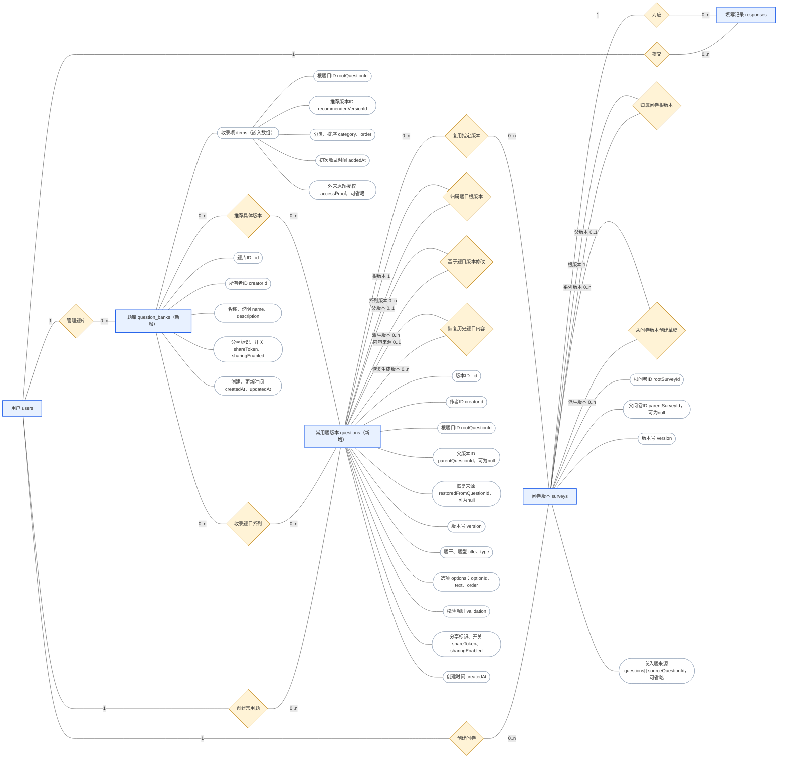

# 基于 MongoDB 的问卷系统项目第二阶段完成报告

姓名：陈宁致

学号：10245501418

项目链接：[OOoolyp/questionnaire-system at phase2](https://github.com/OOoolyp/questionnaire-system/tree/phase2)

报告日期：2026/10/28

## 1 项目目标

第一阶段已完成注册登录、问卷编辑、条件跳转、发布填写、答卷保存及单份问卷统计。第二阶段依据《大作业一：需求变更》中的八项用户反馈，解决题目不能复用、修改影响旧问卷、历史难以追溯和统计局限于单份问卷的问题。

本阶段的总体目标是：让题目成为可以独立保存、分享和管理版本的资源，问卷选用确定版本并保留内容快照，题库负责整理和推荐，统计根据实际来源跨问卷汇总。

### 1.1 八项新增需求与对应设计

| 编号 | 原始新增需求                             | 对应设计与实现                                                                                                                          | 可观察的结果                                                                                 |
| ---- | ---------------------------------------- | --------------------------------------------------------------------------------------------------------------------------------------- | -------------------------------------------------------------------------------------------- |
| 一   | 希望可以保存常用题目，方便以后重复使用   | 新增 questions 集合保存常用题版本；支持独立创建，也支持把问卷中的题另存为常用题。问卷通过 sourceQuestionId 选用具体版本，并复制内容快照 | 创建新问卷时可直接选题，同一版本可用于多份问卷，也可在同一问卷中出现多次                     |
| 二   | 希望可以把题目分享给别人使用             | 每个具体版本有独立 shareToken 与 sharingEnabled；分享入口推荐该版本，并开放同系列其他版本的读取与选用。所有权仍归创建者                 | 接收者登录后可以将共享题加入自己的草稿，不能修改作者原题；关闭链接会阻止基于该链接的新访问   |
| 三   | 希望修改题目时不要影响已经做好的问卷     | 常用题内容版本不可变；问卷内保存完整快照和固定来源。已发布、关闭问卷锁定内容；修改常用题插入新版本                                      | 新版本不会自动替换旧问卷中的题，旧题干、选项、跳转规则与历史答案保持对应                     |
| 四   | 希望系统能记录题目的修改历史             | 用 rootQuestionId 查询系列，parentQuestionId 记录实际修改来源，version 记录创建顺序；恢复时新增版本并记录 restoredFromQuestionId        | 可以查看历史、识别分支和恢复来源；恢复不会抹掉中间版本                                       |
| 五   | 希望同一个题目的不同版本可以同时存在     | 每个版本是一条独立文档，有独立 ID；问卷显式选择来源版本，草稿可以切换同系列版本或转为独立题                                             | A 问卷使用 v1，B 问卷使用 v2，两个版本同时有效、互不覆盖                                     |
| 六   | 希望能查看某个题被哪些问卷使用           | 为 surveys.questions.sourceQuestionId 建立索引，支持按具体版本或整个系列查询引用。作者可看外部受限引用，其他使用者只看自己的引用        | 列表展示问卷版本、状态、引用位置与来源版本；修改前可了解影响范围，而实际修改仍遵守不可变原则 |
| 七   | 希望能建立题目库                         | 新增 question_banks 集合；每项记录根题目、推荐版本、分类和顺序。支持多题库、管理、收录、分享及版本选择                                  | 可从题库选版本加入问卷，也可在编辑器进入题库选题；更新推荐版本不替换已使用的问卷内容         |
| 八   | 希望可以查看单个题目的统计结果（跨问卷） | 按具体 sourceQuestionId 找到本人引用问卷，再按 surveyId 与问卷内 questionId 成对匹配答案，进行 MongoDB 聚合                             | 展示有效答案数、数字均值与区间分布、选择频次、文本频次，以及按问卷拆分的结果                 |

对第六项“修改时可以决定是否创建新版本”，按后续与用户确认的不可变规则落实：修改可复用内容时始终创建新版本；只想在某份草稿中自由修改时，可以先转为独立题。系统没有提供覆盖已有常用题版本的接口。

第八项的“跨问卷”指跨当前用户拥有的问卷，不是全站用户答卷的公开汇总。分享题目只开放内容的读取与使用，不附带他人答卷权限。不同题目版本也不会自动混算。

### 1.2 问卷版本管理

在八项需求之外，实施过程中进一步明确并实现了问卷版本管理：从指定版本创建新草稿、查询历史、支持旧版分支，保留题目配置但不复制答卷。它使“题目改版后形成新一轮问卷”成为完整流程，而不是在旧发布问卷上直接修改。

当前第二阶段新增 29 个业务接口，并提供对应的常用题、题库、分享访问、问卷历史、选题与统计页面。

## 2 系统设计

### 2.1 总体结构

系统沿用 HTML/CSS/JavaScript 前端、FastAPI 后端和 MongoDB 数据库。前端与 API 同源，无需独立前端构建服务；后端用 Pydantic 校验输入，通过 PyMongo 读写数据。用户身份仍由 JWT 与密码哈希机制提供。

新增业务集中在 app/library 和 app/surveys，数据库迁移与索引准备位于 app/core/database.py。前端按 pages 与 shared 拆分，分别承担页面展示和公共选题、授权入口、表单及未保存状态管理。


图中统计节点是业务处理过程，不是新增集合。各板块通过 ID 引用、后端内容复制和授权校验连接，MongoDB 不自动提供这些跨集合外键约束。

### 2.2 问卷板块

**问卷是实际分发与收集答案的单位，每一条 surveys 文档对应一个具体问卷版本。**题目、选项、校验和跳转规则嵌入问卷，使填写时能够整体读取一份稳定定义。

草稿允许编辑；发布后进入收集状态，关闭后保留历史内容和数据。每个问卷版本有自己的 ID、分享标识和答卷。创建新版本会复制标题、说明、开关和题目数组，保留本地题目 ID、选项 ID 与固定来源，但重新生成问卷 ID 和分享标识，将状态设为 draft、截止时间设为 null。

普通保存草稿不增加版本号，只有明确创建新版本才增加。关闭的旧问卷不会因为派生新草稿而重新开放。

### 2.3 常用题板块

**常用题保存独立于问卷的内容：题干、题型、选项和校验规则。问卷中的必答设置、题序和跳转规则属于具体使用场景，不放入常用题内容。**

questions 的一条记录代表一个版本。rootQuestionId 将同一系列组织起来，parentQuestionId 记录真实派生关系。例如已经存在 v1、v2、v3，从 v1 再修改产生 v4，v4 的父版本仍是 v1，而不是编号相邻的 v3。

常用题可以直接创建，也可以从问卷另存。另存会产生属于当前用户的新系列，不自动改变原题，也不自动给原题加来源关联。这样，不需要长期保存的临时题仍可以只嵌入问卷。

### 2.4 题库板块

题库负责整理题目，而不是再复制一份题目内容。每个题库有名称、说明、分享配置以及 items 数组。**收录项用根题目 ID 表示系列，用 recommendedVersionId 表示推荐版本；同系列不能在一个题库里重复收录。**

题库支持两种选题方向：用户在题库中选择题目版本，再选择目标草稿；或在编辑问卷时打开题库并选题。两种方式最终调用相同的后端复制与授权逻辑。

自己的私人题库可以收藏他人授权原题，但这不意味着取得原题编辑权。内部保存原授权，后续访问继续核验；含外来原题的题库不能开启分享，防止私人收藏变成未经授权的再次传播。

### 2.5 各板块如何协同

以“每周学习时长”为例：

1. 作者创建时长题 v1，再修改为 v2；两个版本都保留。
2. 题库收录该系列，推荐 v2；作者也可以分享 v1 的独立入口。
3. 用户从某个入口选择明确版本，将其加入草稿。后端复制内容，生成本地 questionId，记录具体 sourceQuestionId。
4. 问卷发布后，填写者依据该快照提交；答卷记录 surveyId 与本地 questionId，不会因原题后来出现 v3 而改变。
5. 需要改版时，从旧问卷创建新草稿，再显式切换到新题版本。旧问卷和旧答卷不迁移、不覆盖。
6. 查看题目使用情况时按来源 ID 反向查询；查看统计时只聚合同一题目版本在本人问卷中的实际答案。

### 2.6 不可变原则及其边界

不可变指已保存常用题版本的内容不会被原地改写，已发布或关闭问卷的内容不会被**原地**修改。

| 对象或操作     | 允许的变化                                      | 保持不变的部分           |
| -------------- | ----------------------------------------------- | ------------------------ |
| 常用题修改     | 插入新版本                                      | 旧版本内容及既有引用     |
| 恢复历史题目   | 复制旧内容生成新版本，同时记录父来源与恢复来源  | 原历史记录和中间版本     |
| 分享开关       | 修改 sharingEnabled                             | 题目版本内容、作者归属   |
| 题库推荐       | 显式更新 recommendedVersionId、分类和顺序       | 问卷已经选用的来源与快照 |
| 草稿切换来源   | 保留实例 ID、题序与必答设置，换成同系列目标内容 | 其他问卷、原常用题版本   |
| 草稿转为独立题 | 仅移除 sourceQuestionId，随后可独立编辑         | 来源题内容、其他问卷     |
| 问卷改版       | 创建独立新草稿                                  | 旧发布/关闭版本与其答卷  |

对于关联来源的草稿题，普通 PUT 接口也不能绕过保护直接改写来源内容。切换来源时重新验证题型、必答与全卷跳转规则，破坏规则的操作拒绝写入；必要时由用户明确选择清空本题规则。

## 3 MongoDB设计

### 3.1 集合划分与引用方式

| 集合           | 一条文档表示                 | 主要连接                                                                        |
| -------------- | ---------------------------- | ------------------------------------------------------------------------------- |
| users          | 一个账号                     | creatorId、respondentId 指向用户                                                |
| surveys        | 一个具体问卷版本及其题目定义 | rootSurveyId、parentSurveyId 连接版本；嵌入题的 sourceQuestionId 指向 questions |
| responses      | 一次成功提交及其答案         | surveyId 指向具体问卷版本；答案的 questionId 对应该问卷中的题目实例             |
| questions      | 一条常用题内容版本           | rootQuestionId、parentQuestionId、restoredFromQuestionId 连接题目版本           |
| question_banks | 一个题库及收录项             | items 引用题目系列及推荐版本，creatorId 表示管理者                              |

问卷定义和一次答卷经常整体读取、共同校验，使用数组嵌入。答卷数量会随填写增长，因此单独存储，不追加到问卷文档。常用题跨问卷复用并独立版本化，所以单独存储；问卷同时保存快照，使填写不依赖实时修改原题。

### 3.2 集合关系 ER 图（仅展开本阶段新增属性）

采用矩形集合、菱形关系、椭圆属性的表示方式。五个矩形对应实际集合；questions与question_banks展开新增集合属性，surveys只展开新增属性，users与responses不重复标注原有属性。



说明：

- 矩形是实际MongoDB集合；选项、收录项与问卷题目仍是内嵌结构，不是额外集合。items下方属性表示每个收录项的字段。
- 关系上的1、0..1、0..n表示恰好一个、零或一个、零或多个。根版本在第一版时指向自身；父版本和恢复内容来源允许为空。自引用关系的两条边分别标注版本角色。
- 常用题与问卷、题库之间按集合文档统计是多对多；每个复用实例只指向一个具体版本，每个收录项只指向一个系列和一个推荐版本。同题库对同系列最多收录一次，同问卷可以多处复用同版本。
- responses通过surveyId连接具体问卷版本，答案中的本地questionId连接问卷嵌入题，不直接引用questions。原有嵌入题、选项、答案结构未单列为集合或重复标注旧属性。
- 关系由应用检查，不代表MongoDB自动执行跨集合外键约束。各唯一索引、部分唯一索引和来源多键索引见3.7节。

### 3.3 统计与查询策略

统计以成功保存的真实答卷实时聚合，不另建累计计数集合。数字用十进制处理中间均值与分桶，区间为左闭右开；多选比例以本题有效答案数为分母，允许合计超过100%；文本按相同内容汇总前20项频次。

### 3.4 为什么不采用完全拆分的关系数据库结构，而使用MongoDB

关系数据库同样可以实现本项目。这里的选择不是因为关系数据库不能保存问卷或处理版本，而是当前系统**以“一份问卷定义”和“一次完整提交”为主要读写单位，文档结构更贴近这些业务边界。**

如果采用较充分的关系表拆分，通常需要分别保存问卷版本、问卷内题目、常用题版本、选项、跳转规则、填写记录、答案、多选答案关联和题库收录关系。读取一份完整问卷时，需要连接或分批查询这些记录并重新组装；复制问卷版本、顺移题序、替换规则和保存整份答卷时，也需要协调多条记录的写入。关系数据库可以通过事务保证一致性，但在本项目中会增加表之间的组织与操作步骤。

不同题型还具有不同字段，而是使用文档数据库可以通过设计适配不同题型的需求：选择题有选项数组，多选题有选择数量限制，文本题有字符长度限制，数字题有数值范围与整数限制。若全部放入统一的关系表，会出现较多不适用的空字段；若按题型拆分，则增加表和查询组合。

## 4 AI使用过程

本阶段使用Codex辅助需求讨论、实现、测试、页面联调和文档编写。用户负责提出目标、选择方案并修订规则，AI根据已确认范围逐步实施。

| 阶段             | 用户提供的决策或反馈                                 | AI参与的主要工作                                               |
| ---------------- | ---------------------------------------------------- | -------------------------------------------------------------- |
| 需求建模         | 提出单集合新插入版本、父版本与根版本，要求联合索引   | 比较母题/子题双集合与单集合方案，落实版本字段和查询方式        |
| 权限与不可变规则 | 要求只有作者可修改、分享可选版本、保留不可变规则     | 将分享读取与原题编辑权分开，设计推荐入口、复制快照和显式切版   |
| 分阶段开发       | 要求先列计划，整理目录，再逐阶段实现与检查           | 编写模型迁移、版本、复用、题库分享、使用统计及对应页面         |
| 测试与纠正       | 要求测试代码在tests下，并保留数据供前端观察          | 添加真实数据库测试、受控并发与数值边界测试，执行回归并记录问题 |
| 成果展示         | 要求一个账号呈现所有阶段成果，并说明从数据库开始启动 | 通过正式API生成showcase账号、题库、版本和答卷，整理演示步骤    |
| 提交材料         | 指定四份说明及本报告的结构                           | 核对源码、OpenAPI与实际测试结果，编写有代码定位的说明          |

AI不是只生成初稿：当测试发现版本碰撞、旧状态覆盖风险或数值边界问题时，继续定位和修复，再用相应断言复验。与此同时，自动测试和AI浏览器联调不能等同于提交者已经逐行审查全部代码，也不能替代最终人工确认。

本报告中的模拟答卷不是现实调查数据，测试数字来自实际执行或明确标注的历史记录，不将AI推测写成实测结果。本次编写完成报告没有修改业务代码或再次运行数据生成脚本。

## 5 测试结果

### 5.1 最近一次完整自动回归

最近一次完整复验为 2026年10月28日，运行于Windows、Anaconda Python 3.12.13和本地真实MongoDB。后端使用unittest与FastAPI TestClient，前端纯逻辑使用Node.js内置测试工具。

| 分类               | 测试文件                      | 通过数       | 重点                                               |
| ------------------ | ----------------------------- | ------------ | -------------------------------------------------- |
| 模型、迁移与索引   | test_foundation.py            | 7            | 可重复迁移、部分迁移保护、唯一与来源索引           |
| 常用题版本         | test_library.py               | 7            | 四题型、分支、恢复、不可变、选项身份、并发版本     |
| 题目复用           | test_reuse.py                 | 11           | 另存、插入、切版、detach、规则、旧来源和读写竞争   |
| 问卷版本           | test_survey_versions.py       | 9            | 新草稿、历史、旧状态、答卷隔离、并发及碰撞         |
| 分享与题库         | test_sharing_banks.py         | 14           | 推荐入口、归属、收藏授权、撤销、题库条件更新       |
| 使用追踪与统计     | test_question_analytics.py    | 10           | 成对匹配、引用计数、隐私、三类分布、极端数值       |
| 原接口及兼容回归   | test_surveys.py               | 37           | 原有问卷闭环、来源元数据与前端资源模块图           |
| 后端合计 | tests/backend             | 95 | 失败0、错误0、跳过0                      |
| 前端逻辑           | tests/frontend中的4个测试文件 | 15 | 表单、分享链接解析、填写路径和未保存保护，全部通过 |

其中第二阶段专项文件合计58项，加37项兼容回归等于95项，不重复累计。同一测试内部的多个断言不另计项目数。

执行方式：

```powershell
python -X utf8 -m unittest discover -s tests/backend -v
node --test tests/frontend/*.test.mjs
```

本轮最初因MongoDB未启动发生连接拒绝，使用原数据目录启动数据库后重新执行获得上述最终结果；没有以忽略失败测试替代环境修复。详细输入、预期和实际结果见05 测试用例与结果。

### 5.2 典型验证结果

- 8个并发请求从同一题目或问卷父版本创建分支，得到不同编号和分享标识，父版本关系保持正确。
- 草稿读后被发布或被其他请求改动时，后续旧状态写入返回409，不覆盖已保存内容。
- 同一问卷内使用不同题目版本并提交5、50和独立题500时，两来源分别统计5、50，500不混入。
- 复制问卷保留相同本地题目ID、但切到不同来源版本后，旧版与新版答案仍分别统计。
- 作者可以看到外部引用，却不能读取或汇总外部答卷；使用者在原分享撤销后仍可统计自己已经收集的答案。
- 两个1e308求均值及1e-300宽度分桶仍能返回合法JSON；0.3/0.1与负数分桶边界正确。

### 5.3 保留前端功能展示账号

完整展示账号为showcase，基于保留的questionnaire_demo_usage库，初始含8个问卷版本、66份答卷、3个题库、7道常用题的11个版本。其时长v2聚合为24次提交、30次有效答案、均值9.6，可直观看到同题多处引用时“答案数大于提交数”。

展示数据通过生成脚本`scripts/seed_analytics_demo.py`和`scripts/seed_showcase.py`调用正式API产生，使用数据库`questionnaire_demo_usage`。

## 6 遇到的问题

| 编号 | 问题                                     | 对系统的影响                                                               |
| ---- | ---------------------------------------- | -------------------------------------------------------------------------- |
| P01  | “修改原题”与“历史问卷内容稳定”相冲突 | 原地改题会使已收集的答案失去对应定义                                       |
| P02  | 分支版本的编号与真实父关系不同           | 直接把父版本视作version-1，会记录错误修改来源；恢复还涉及两个不同来源      |
| P03  | 多人同时派生版本或编辑草稿               | 最大版本取号可能碰撞，旧题目数组可能覆盖其他请求，读后发布可能被旧写入破坏 |
| P04  | 切换版本会改变选项、题型或限制           | 原跳转条件可能引用已删除选项，必答设置也可能与新限制不相容                 |
| P05  | 分享与收藏容易被误当成所有权转移         | 接收者可能修改原题、再传播私人收藏，或在授权撤销后继续访问来源             |
| P06  | 同一题目ID在问卷版本复制后继续存在       | 只按本地questionId跨问卷聚合，会将不同来源版本的答案混算                   |
| P07  | 提交次数、引用处数和答案数容易混淆       | 同题多处引用、跳过和重复提交会使计数不相等，多选比例也不一定合计100%       |
| P08  | 自动测试夹具与前端演示的需要不同         | 测后立即删库不便展示，单个随机测试库也未必形成完整可理解的业务场景         |

## 7 如何解决

### 7.1 P01、P02：用新文档保存变化，用两个来源表达恢复

常用题保存为不可变版本，问卷保留固定来源的完整快照，禁止发布后内容覆盖。修改插入新版本，恢复也插入新版本；root负责系列，parent负责真实派生，version只负责序号，restoredFrom负责内容来源。由此既能回看旧内容，也能表达分支和恢复，而不依赖易失真的“上一版本”假设。

### 7.2 P03：唯一约束与单文档旧状态匹配

对根ID＋版本号和分享标识建立唯一索引，插入碰撞后重新取号并有限重试。编辑草稿时匹配读取到的旧题目数组和draft状态；题库修改匹配旧名称、说明、items和分享状态。发现冲突返回409让调用者刷新，不静默覆盖。

这解决了已测试的版本碰撞和丢失更新场景，但不是跨集合事务，也不宣称所有同时发生的撤销、统计和编辑都被全局串行化。

### 7.3 P04：保留实例身份，重新验证完整结构

切换版本保留questionId、题序与必答，避免其他题的入站跳转失去目标；复制新内容后验证当前题型约束及全卷规则。新版删除规则选项时拒绝，用户可以明确清空本题出站规则后再切换。需要完全独立修改时先detach，保留原内容与规则，避免假装仍与来源版本一致。

### 7.4 P05：分开管理权、内容使用权与答卷访问权

管理接口只认创建者，分享只授予指定系列读取和选用。外来收藏保存的授权不对外暴露，并在后续访问时重验；禁止含外来原题的题库开启分享。撤销后阻止新访问，已使用快照和历史答卷继续保留。外部引用只展示必要的使用信息，不提供他人问卷详情或答卷。

### 7.5 P06、P07：按来源版本和问卷实例成对聚合

先按具体sourceQuestionId找本人问卷，再按surveyId与questionId匹配答案，防止仅按相同本地ID混入其他版本。接口分别返回submissionCount、answeredSubmissionCount与answerCount，页面明确按次数统计而非去重人数。

选择题补齐零次选项，多选比例以答案数为分母；跳过不算作数值0，真实0正常统计；题目系列范围只扩大使用追踪，不擅自扩大为不同题目版本的答案混合统计。

### 7.6 P08：保留隔离测试结果，另建完整成果场景

测试结束默认保留隔离库，同时提供带本地操作记账的增量生成脚本，在同一个展示账号中组织旧版、新版、草稿、共享题库、外来收藏和真实答卷。重复执行复用已完成操作，不为恢复初始数量而删除用户后续操作。这样自动回归与现场展示各自有清晰的数据来源，原有数据也继续保留。

上述设计已形成从常用题创建、版本派生、题库整理、分享选用，到问卷发布、历史答卷保留和跨问卷统计的完整流程。当前验证范围是本地功能与指定并发、权限和数值边界，没有进行大规模负载或跨机器生产部署验证。
